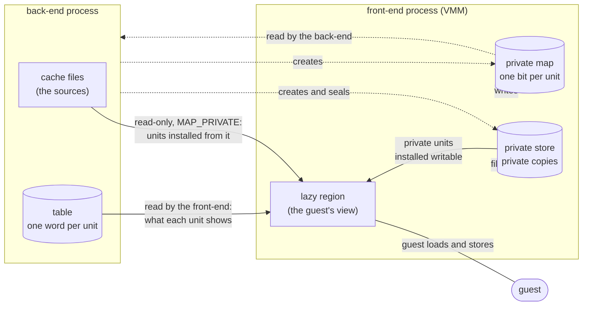
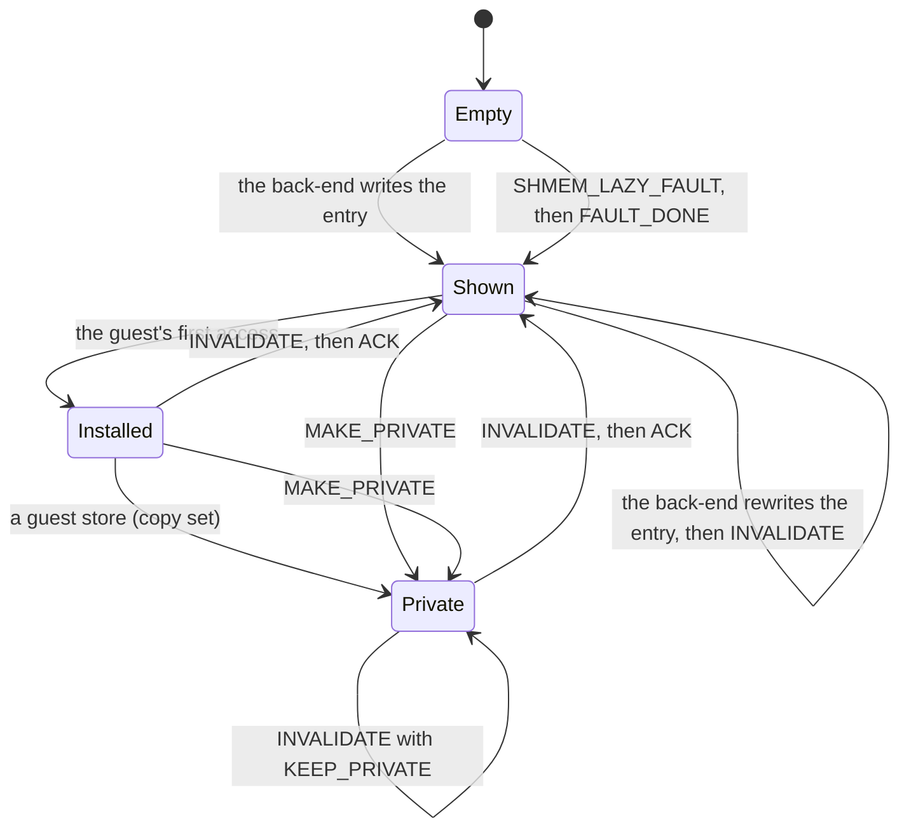
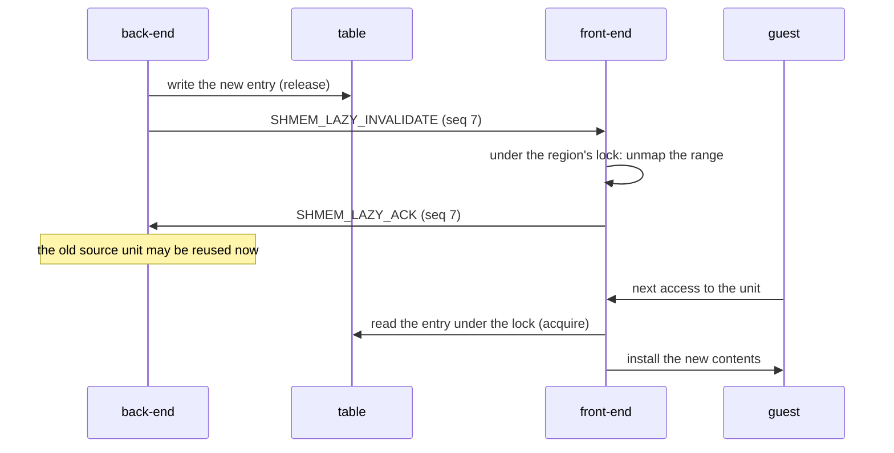
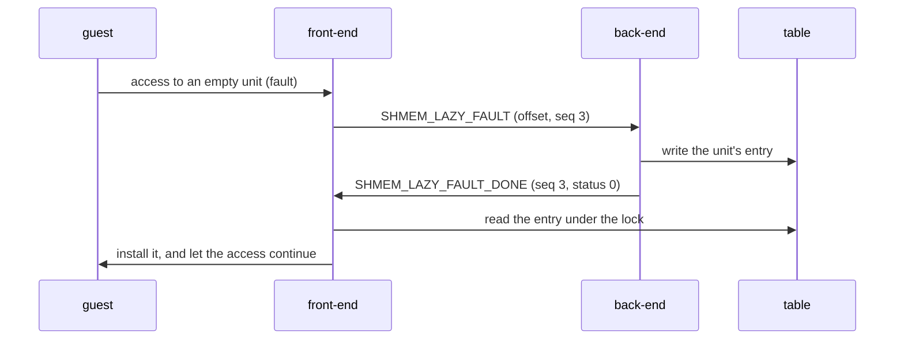

# vhost-user: lazy shared memory regions, directed by the back-end

> **Superseded** (2026-11-28, the user's decision, board 14378): no vhost-user extent device. A
> back-end could reach a memory cell's private pages, anonymous memory in the VM process, only
> through `process_vm_readv`, which the user judged too slow and complex for what it saves. The
> direction now: doc-4's requests over stock vsock, Firecracker copying from guest memory, and the
> DAX window as a stock virtio-pmem device whose memory is the same lazily mapped region of the
> daemon's memfd runs, copied on write, as guest RAM's (`docs/research/guest-ram-mapping-list.md`,
> board 14602): one generic patch in the fork. The back-end (cladefsd's `server/vhost.rs`, the
> `vhost_user` crate, boards 14537, 14603, 14620) is backed out of main; kept for its reasoning.

This is a proposal of additions to the vhost-user protocol (QEMU's `docs/interop/vhost-user.rst`),
meant for the vhost-user specification and for front-ends such as QEMU, Firecracker and Cloud
Hypervisor. It builds on `VHOST_USER_PROTOCOL_F_SHMEM` and its `VHOST_USER_BACKEND_SHMEM_MAP` and
`VHOST_USER_BACKEND_SHMEM_UNMAP` messages.

The message numbers and the two protocol feature bits are placeholders until the specification
allocates them. The proposal uses the specification's terms: the **front-end** (the VMM), the
**back-end** (the process that implements the device), and the **back-end channel**, the socket the
back-end sends requests to the front-end on (`VHOST_USER_PROTOCOL_F_BACKEND_REQ`).

## 1. Motivation

`VHOST_USER_BACKEND_SHMEM_MAP` asks the front-end to `mmap` a range of a file into a VIRTIO shared
memory region, immediately, read-only or read-write. A mapping may not overlap another, and can only
be unmapped whole. That suits a device with a few fixed mappings. It doesn't suit a device whose
shared memory region is a large, sparse window onto a cache the back-end manages, such as:

- **a file system's DAX window** (virtio-fs's DAX support stalled on exactly these limits): the guest
  maps many file ranges, touches a few pages of each, and remaps often;
- **a cache shared between guests**: one host page shown to many guests, each given a private copy
  only of the pages it writes;
- **blob resources** (virtio-gpu) placed and replaced while the guest runs.

Such a device needs four things of the front-end that `SHMEM_MAP` can't give:

1. **Lazy installation.** A page appears in the guest when the guest first touches it, not when the
   back-end maps it. A mapping then costs nothing until it's used, and remapping a page the guest
   never touched flushes nothing. The front-end also keeps the number of host mappings it creates
   within its own limits.
2. **Copy on write.** A guest store to a page gives that guest a private copy; a later remap of the
   page discards the copy. A plain `MAP_PRIVATE` mapping can't provide this under KVM on x86: KVM's
   asynchronous page fault worker requests write access even for guest loads, so loads would create
   copies too.
3. **Replacing and partial unmapping.** Mapping over pages that are already mapped, and unmapping part
   of a mapping.
4. **No message per mapping.** When the back-end serves the guest's virtqueue requests directly, a map
   message sent over the back-end channel races the guest seeing the request's completion in the used
   ring. And a device that maps pages on every request can't afford a round trip for each.

This proposal moves that mechanism into the front-end, in a generic form, driven by a table the
back-end writes.

## 2. Overview

A back-end that negotiates `VHOST_USER_PROTOCOL_F_SHMEM_LAZY` may make any of its device's shared
memory regions **lazy**. A lazy region is divided into fixed-size **units**: a power of two of at
least 4096 bytes, which the back-end chooses when it sets the region up. (This document says "page"
only for the host's or guest's MMU pages.) A lazy region has three parts:

- **Sources**: files the back-end gives the front-end, read-only, whose contents units show.
- **The table**: memory the back-end writes and the front-end reads, one entry per unit. An entry says
  what the unit shows (a unit of a source, zeros, or nothing yet) and whether a guest store to it makes
  a private copy.
- **The private store and the private map**: memory, laid out like the region, where the front-end
  keeps private copies of units, and a bitmap saying which units are private.

Who creates, writes and maps each part:



A walkthrough of one unit's life:

1. The back-end shows a unit by writing its table entry, for example "unit 12 of source 3,
   copy-on-write". It sends no message.
2. The guest reads the unit. The front-end takes the fault, reads the entry, and maps unit 12 of
   source 3 into the region, read-only.
3. The guest writes the unit. The front-end copies the unit into the private store, sets its bit in
   the private map, and maps the private copy writable in its place.
4. The back-end wants the unit to show something else. It writes the new entry, then sends
   `SHMEM_LAZY_INVALIDATE`. The front-end unmaps the unit, discards the private copy, and acknowledges.
   Only after that acknowledgement does the back-end reuse unit 12 of source 3 for anything else.
5. If the guest touches a unit whose entry is still empty, the front-end asks the back-end with
   `SHMEM_LAZY_FAULT`. The back-end writes the entry and answers with `SHMEM_LAZY_FAULT_DONE`, and
   the front-end goes back to step 2.

No message waits for a reply on its own channel. Each request carries a **sequence number**, and each
answer is a separate message that names the sequence number it answers.

## 3. Requirements

`VHOST_USER_PROTOCOL_F_SHMEM_LAZY` (bit TBD) requires these protocol features too:

- `VHOST_USER_PROTOCOL_F_SHMEM` (22), for the device's shared memory regions and their sizes
  (`VHOST_USER_GET_SHMEM_CONFIG`);
- `VHOST_USER_PROTOCOL_F_BACKEND_REQ` (5), for the back-end channel, which carries the messages of
  section 5.1;
- `VHOST_USER_PROTOCOL_F_BACKEND_SEND_FD` (10), for file descriptors sent with back-end messages.

`VHOST_USER_PROTOCOL_F_SHMEM_LAZY_PRIVATE` (bit TBD) is optional and requires
`VHOST_USER_PROTOCOL_F_SHMEM_LAZY`. It adds two messages, `SHMEM_LAZY_PREFAULT` and
`SHMEM_LAZY_MAKE_PRIVATE` (section 5.3).

`VHOST_USER_PROTOCOL_F_REPLY_ACK` isn't needed: no message of this proposal sets
`VHOST_USER_NEED_REPLY_MASK`.

## 4. Data structures

### 4.1 Units and offsets

The back-end chooses a region's unit size in `SHMEM_LAZY_SETUP`. Every `offset` and `len` field of
every message is in bytes and is a multiple of the unit size. A front-end whose host pages are larger
than the unit size must still present each unit correctly, for example by building a host page from
several units. A front-end that can't support the unit size it is given refuses the setup.

### 4.2 The table

The back-end creates the table, sized `region size / unit size × 8` bytes, and seals it against
shrinking and growing (`F_SEAL_SHRINK | F_SEAL_GROW`). The front-end maps it read-only.

The table holds one little-endian 64-bit word per unit. The back-end stores each word whole, with
release semantics; the front-end loads it whole, with acquire semantics. So the front-end never sees
half of an old entry and half of a new one.

```
bits 63..62  kind:        0 empty, 1 source, 2 zeros, 3 reserved
bit  61      copy:        a guest store makes the unit private
bits 60..48  source:      the source's index (kind 1), else 0
bits 47..0   source_unit: the unit number within the source (kind 1), else 0
```

- An **empty** unit shows nothing. A guest access to it makes the front-end send `SHMEM_LAZY_FAULT`.
- A **source** unit shows bytes `source_unit × unit size` through `(source_unit + 1) × unit size` of
  the source.
- A **zeros** unit shows zeros.
- With `copy` set, a guest store makes the unit private: a source unit's contents are copied into the
  private store, and a zeros unit becomes a zero-filled private unit. With `copy` clear, a guest store
  to the unit fails, as a store to a read-only mapping does.

The front-end validates each entry it reads. It treats an unknown kind, a source index it wasn't
given, or a `source_unit` past the source's end as an empty unit, and never accesses memory out of
bounds.

### 4.3 The private store and the private map

The back-end creates the private store, as large as the region, and seals it against shrinking and
growing. The front-end maps it read-write and shared, and keeps each private unit at that unit's own
offset in it. Pages of the private store are charged, in memory accounting, to the process that first
writes them, which is normally the front-end.

The back-end also creates the private map, one bit per unit (bit `n % 8` of byte `n / 8` for unit
`n`), and seals it the same way. The front-end maps it read-write; the back-end maps it read-only. Bit
`n` set means unit `n` is private, and its contents in the private store are the guest's.

The front-end sets a unit's bit, with release semantics, only after the unit's contents are in the
private store. It clears the bit before it discards the unit's pages from the private store (for
example with `fallocate(FALLOC_FL_PUNCH_HOLE)`).

## 5. Messages

Two independent sequence-number spaces are used. The back-end numbers its messages for each region,
in order, starting at 1; the front-end acknowledges them in that order (`SHMEM_LAZY_ACK`). The
front-end numbers its faults in a space of its own, and the back-end answers them in any order
(`SHMEM_LAZY_FAULT_DONE`).

Below, each message's full name is given once; elsewhere the document drops the
`VHOST_USER_BACKEND_` or `VHOST_USER_` prefix, as in `SHMEM_LAZY_SETUP`.

### 5.1 Back-end to front-end, on the back-end channel

**`VHOST_USER_BACKEND_SHMEM_LAZY_SETUP`** (number TBD), with three file descriptors, in this order: the
table, the private store and the private map.

```
u8  shmid       the shared memory region
u8  padding[3]
u32 unit        the unit size in bytes: a power of two, at least 4096
u64 seq
```

Makes the region lazy. Until the front-end acknowledges `seq`, the back-end sends nothing else for the
region, and guest accesses to the region wait.

**`VHOST_USER_BACKEND_SHMEM_LAZY_SOURCE`** (number TBD), with one file descriptor: the source.

```
u8  shmid
u8  padding
u16 index       the source's index, below 8192
u32 padding
u64 size        the source's size in bytes, a multiple of the unit size
u64 seq
```

The front-end maps the whole source privately and read-only (`MAP_PRIVATE` of a read-only file
descriptor, since Linux refuses to register a shared read-only mapping with userfaultfd), and installs
units from that mapping. Each index may be given at most once and is never reused. The front-end can
read every byte of each source, whatever the table shows, so a back-end gives only files whose every
byte the guest may see.

**`VHOST_USER_BACKEND_SHMEM_LAZY_INVALIDATE`** (number TBD):

```
u8  shmid
u8  flags       bit 0: KEEP_PRIVATE
u16 padding[3]
u64 offset
u64 len
u64 seq
```

The front-end unmaps every unit in the range. Unless `KEEP_PRIVATE` is set, it also discards the
range's private copies: it clears their bits in the private map, then discards their pages from the
private store. It acknowledges `seq` once no unit in the range is still mapped from a table entry it
read before the invalidation.

**`VHOST_USER_BACKEND_SHMEM_LAZY_FAULT_DONE`** (number TBD):

```
u8  shmid
u8  padding[3]
i32 status      0, or a negative errno
u64 seq         the SHMEM_LAZY_FAULT this answers
```

With `status` 0, the back-end has written the unit's table entry: the front-end reads it again,
installs the unit and lets the guest's access continue. With a negative `status`, the unit stays empty
and the guest's access fails.

### 5.2 Front-end to back-end, on the main channel

**`VHOST_USER_SHMEM_LAZY_FAULT`** (number TBD):

```
u8  shmid
u8  padding[7]
u64 offset      the byte offset of the empty unit the guest accessed
u64 seq         in the front-end's own sequence-number space
```

Sent when a guest accesses a unit whose table entry is empty. The back-end writes the entry, or
refuses, and answers with `SHMEM_LAZY_FAULT_DONE`. Several faults may be outstanding at once.

**`VHOST_USER_SHMEM_LAZY_ACK`** (number TBD):

```
u8  shmid
u8  padding[3]
i32 status      0, or a negative errno
u64 seq         in the back-end's sequence-number space
```

Acknowledges the back-end's messages for the region in order. Acknowledging `seq` also acknowledges
every earlier `SETUP`, `SOURCE` and `INVALIDATE` of the region, with status 0. The front-end
acknowledges each `SHMEM_LAZY_MAKE_PRIVATE` with an `ACK` of its own, which carries that request's
status; a later `ACK` never acknowledges a `MAKE_PRIVATE` that hasn't had one. A `SETUP` or `SOURCE`
the front-end refuses also gets an `ACK` of its own, with a negative status.

### 5.3 The optional messages (`VHOST_USER_PROTOCOL_F_SHMEM_LAZY_PRIVATE`)

These two messages, back-end to front-end on the back-end channel, serve devices whose back-end acts
on the region ahead of the guest. `SHMEM_LAZY_PREFAULT` installs units the guest is about to access,
saving a fault each. `SHMEM_LAZY_MAKE_PRIVATE` is for a back-end that writes bytes into units the
guest will read: for example a device whose back-end serves a guest's read request by writing the data
directly into the lazy region, rather than pointing a table entry at a source. Before writing, the
back-end makes the units private; with `NO_COPY` the front-end skips copying their old contents,
because the back-end will overwrite them.

**`VHOST_USER_BACKEND_SHMEM_LAZY_PREFAULT`** (number TBD):

```
u8  shmid
u8  padding[7]
u64 offset
u64 len
```

A hint to install the range before the guest accesses it. It isn't acknowledged.

**`VHOST_USER_BACKEND_SHMEM_LAZY_MAKE_PRIVATE`** (number TBD):

```
u8  shmid
u8  flags       bit 0: NO_COPY
u16 count       the number of ranges that follow, at most 64
u32 padding
u64 seq
struct { u64 offset; u64 len; } ranges[count]
```

Makes every range private now, as guest stores would, as one change: either all of them or none. The
front-end keeps a limit on how many private units it holds; past it, it acknowledges with `-ENOMEM`
and makes none of them private.

## 6. Ordering rules

A unit's life, as the front-end sees it:



"Shown" means the table says what the unit shows, but the front-end hasn't installed it yet.

The back-end rewrites an entry and invalidates it before reusing a source unit:



A guest access to an empty unit, which the back-end resolves:



The rules:

1. **Mapping.** To make an empty unit show something, the back-end writes its entry; no message is
   needed. A back-end that maps units as part of serving a virtqueue request writes their entries
   before it writes the request's completion to the used ring.
2. **Remapping and unmapping.** To change an entry that isn't empty, the back-end writes the new entry
   first, then sends `SHMEM_LAZY_INVALIDATE`. It reuses the old source unit only after the front-end
   acknowledges the invalidation. The back-end sends `INVALIDATE` after every rewrite of an entry the
   front-end might have installed.
3. **Installing.** The front-end installs units and applies invalidations under one lock per region.
   It reads a unit's entry while holding that lock, and reads it again after any wait, such as for a
   `FAULT_DONE`. So an install and an invalidation never interleave, and nothing invalidated is
   installed again from its old entry.
4. **Private units.** The front-end sets a unit's private bit only after the unit's contents are in
   the private store, and clears it before discarding them. The back-end reads private units from the
   private store and other units from their sources. It writes only units whose private bit it saw set
   after the front-end acknowledged its `MAKE_PRIVATE`, and only until it completes the request that
   needed them.
5. **No blocking.** Neither side blocks a thread that serves other work while waiting for an answer
   from the other side. Answers are matched to requests by sequence number.

## 7. Interactions with the rest of the protocol

**Stopping a queue.** `VHOST_USER_GET_VRING_BASE` blocks until the back-end completes the queue's
in-flight requests. Some of them may be waiting for the front-end to acknowledge an `INVALIDATE` or a
`MAKE_PRIVATE`; and guest accesses to the region may be waiting for a `FAULT_DONE`. To avoid a
deadlock, the front-end handles this proposal's messages on a thread other than the one waiting for
`GET_VRING_BASE`'s reply, or uses `VHOST_USER_PROTOCOL_F_INFLIGHT_SHMFD` so that `GET_VRING_BASE`
doesn't wait for in-flight requests to drain.

**Device state and snapshots.** A lazy region's table and sources are part of the back-end's state
(`VHOST_USER_PROTOCOL_F_DEVICE_STATE`). Its private units are the front-end's memory. A front-end that
snapshots the device saves the private store and private map with its own state, and restores their
contents when it sets the region up again; or the back-end refuses to snapshot while any unit is
private, which it can tell from the private map.

**Dirty logging.** When the back-end writes units, it logs those writes as it logs any write to guest
memory (`VHOST_F_LOG_ALL`, `VHOST_USER_SET_LOG_BASE`): for this purpose the private store counts as
guest memory. Units made private by guest stores are dirtied in the front-end's own memory, and the
front-end logs them as it logs any other page.

**Reset.** `VHOST_USER_RESET_DEVICE` tears down every lazy region: the front-end unmaps every unit,
discards every private unit, and drops the sources, the table, the private store and the private map.

**Guest RAM.** A memory region of `VHOST_USER_SET_MEM_TABLE` could be made lazy in the same way, with
its own table, sources and private store, so that a guest's memory is shown from a cache shared with
other guests and restored from snapshots without copying. That is out of scope here: it changes how
the front-end allocates guest memory, not just a device's shared memory region, and needs a proposal
of its own.

## 8. Front-end implementation notes

- **Faults.** On Linux, a front-end registers the region with userfaultfd for missing-page faults, and
  each installed unit for write-protect faults. It resolves a missing-page fault from the table, and a
  write-protect fault on a unit with `copy` set by making the unit private.
- **KVM's asynchronous page faults.** KVM's async page fault worker requests write access even when
  the guest only loads, so a write fault from that worker can't be told apart from a guest store. The
  front-end therefore makes a unit private only for a write fault taken on one of the guest's vCPU
  threads. It resolves a fault from the async worker as a read, mapping the unit read-only; if the
  guest was really storing, the store faults again on the vCPU thread, and copy-on-write happens then.
- **Mapping limits.** Each contiguous run of installed units from one source is one mapping in the
  front-end's process, and the kernel limits how many a process may have (`vm.max_map_count`). The
  front-end keeps within a budget of its own, unmapping the units installed longest ago when it must;
  the back-end never sees this.
- **One fault handler per front-end process.** A front-end with several lazy regions, of one or
  several devices, serves all of them with one fault-handling thread and one mapping budget.
- **Hosts without userfaultfd**, such as macOS with Hypervisor.framework, resolve the guest's faults on
  the region from the hypervisor's exits instead; the protocol doesn't change.

## 9. Security considerations

- **The front-end trusts the back-end**, as it trusts any vhost-user back-end. It validates table
  entries only so that it never accesses memory out of bounds (section 4.2).
- **The back-end trusts nothing of the front-end**, which may be a jailed, untrusted process serving
  one tenant while the back-end serves many. The back-end creates the table, the private store and the
  private map itself, sealed, so the front-end can't resize them under it. It treats the private map
  as untrusted input. It never blocks a thread that serves other front-ends while waiting on this
  one. If a front-end stops acknowledging, the back-end disconnects it after a timeout, and doesn't
  reuse the source units it was invalidating until then.
- **Sources are wholly readable** by the front-end, whatever the table shows, so a back-end gives a
  front-end only files whose every byte its guest may see.
- **Memory charged to the back-end.** If a misbehaving front-end discards a private unit's pages while
  leaving its private bit set, a back-end write to that unit allocates a new page, charged to the
  back-end. A back-end that must prevent this writes through a mapping on which a missing page faults
  (for example catching `SIGBUS`), or accepts the exposure, which is bounded by the region's size.

## 10. Open questions

1. Is one word per unit the right table, or would a list of extents scale better for large regions?
   At 8 bytes per 4 KiB unit, an 8 GiB region's table is 16 MiB.
2. Should `SHMEM_LAZY_FAULT` be optional, for devices whose back-end writes every entry before the
   guest could touch it?
3. Is a 13-bit source index (8192 sources) enough for a back-end whose cache spans many files?
